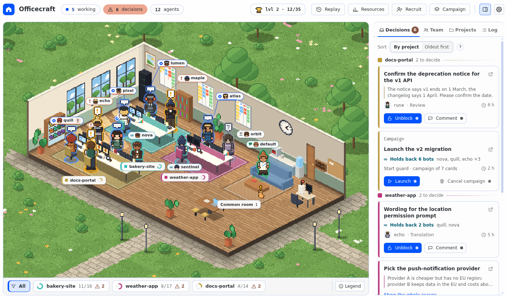
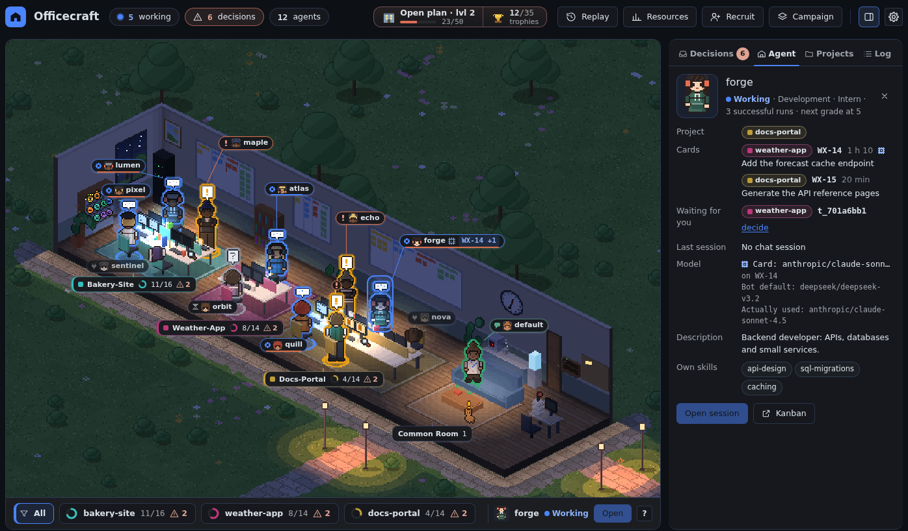
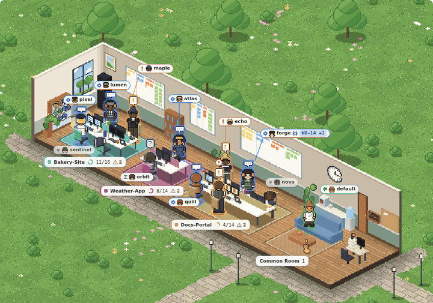
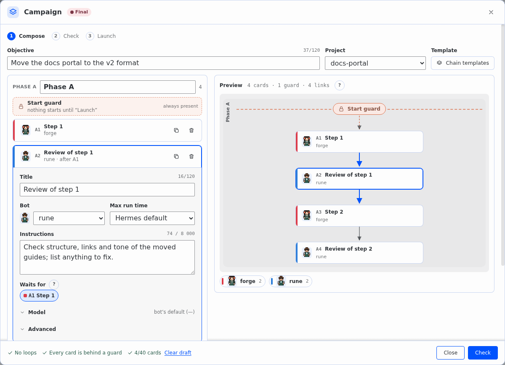
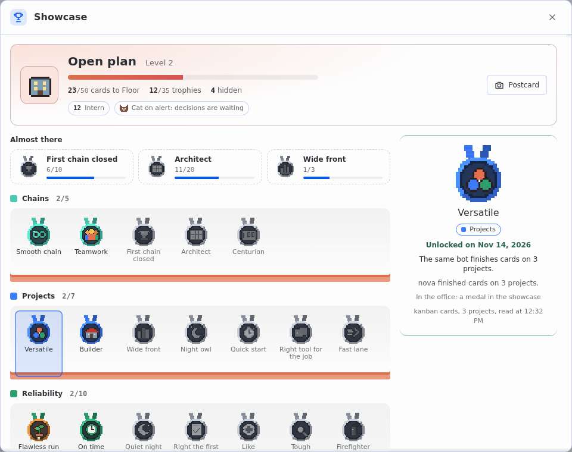
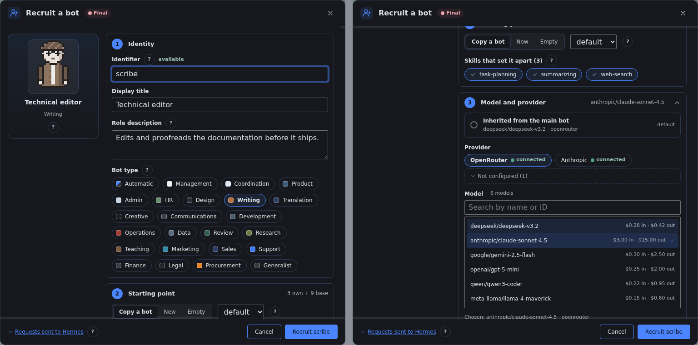
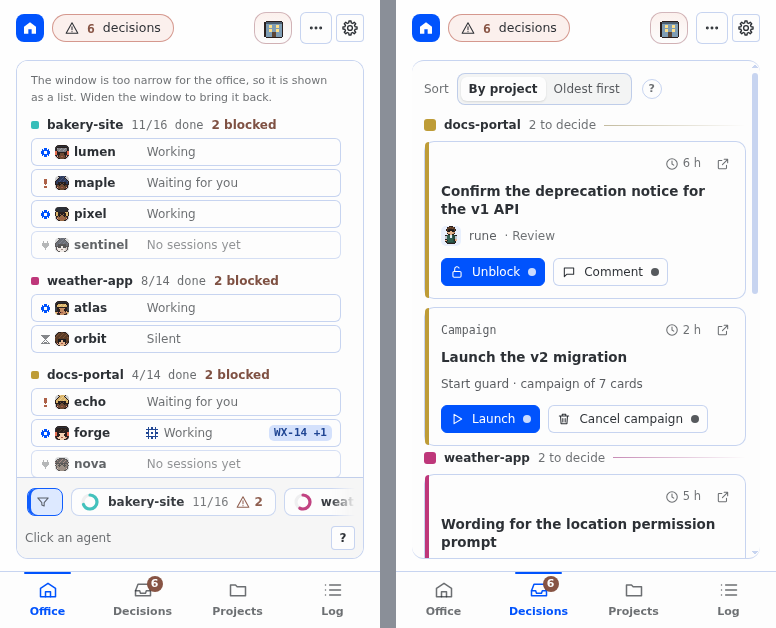

<div align="center">

# Officecraft

**The pixel-art office & kanban control room for [Hermes Agent](https://github.com/NousResearch/hermes-agent)**

See what your agents and kanban chains are doing — and act on them.

[](https://github.com/KosmGit/hermes-officecraft/actions/workflows/ci.yml)
[](LICENSE)




</div>

Officecraft draws your Hermes profiles as people in an isometric office, one island per kanban board. At a glance you see who is working, who went silent, which cards are blocked and waiting for you, and whether the gateway, messaging and scheduled jobs are healthy.

**Nothing is simulated.** Every desk, state and counter is read from your Hermes backend. An empty office is preferred to a fake one.

## Features

| | |
|---|---|
| **Live office** | One desk per agent, one island per project. States are read, not declared: *working*, *active*, *waiting for you*, *silent*, *idle*. |
| **Decisions inbox** | Blocked cards and approval requests, grouped by project. Unblock, comment or answer without leaving the page. |
| **Campaigns** | Compose a graph of cards, preview it, create it in one write. A guard card holds everything until you press *Launch*. |
| **Recruit** | Create a new bot from the office: identity, starting point, model and provider. |
| **Replay & Resources** | Put the office back as it was last night; read tokens, calls and costs as Hermes recorded them. |
| **Notifications** | Decisions, silent agents, the Hermes gateway, scheduled jobs and more, on the messaging apps Hermes already serves. Off by default. |
| **Game layer** | 35 trophies, an office level and agent grades, all recomputed from your real history. One switch turns it off. |
| **LLM functions** | Ten optional helpers (draft a recruitment, propose a campaign graph, decorate the office…). All off by default, capped per month, and a model never creates anything without your click. |

<table>
  <tr>
    <td width="50%"></td>
    <td width="50%"></td>
  </tr>
  <tr>
    <td></td>
    <td></td>
  </tr>
  <tr>
    <td></td>
    <td align="center"></td>
  </tr>
</table>

<sub>Screenshots use a made-up team and made-up projects. The screens themselves are the real ones.</sub>

## Install

Requires Hermes Agent **0.23.0 or later**.

```bash
hermes plugins install https://github.com/KosmGit/hermes-officecraft --enable
hermes gateway restart
```

Then switch on the desktop half in **Capabilities → Plugins** (desktop plugins ship off by default) and open **Officecraft** in the sidebar.

- **From the app**: *Capabilities → Plugins → Install from Git*, paste the repository URL, then restart the gateway.
- **In a browser**: set `webapp.enabled: true` in your Hermes `config.yaml`, restart the gateway and run `hermes webapp`.
- **Update**: `hermes plugins update hermes-officecraft`, then restart the gateway.

Without the agent half (remote backend where it is not installed, older Hermes) the office still shows every agent with its state, read-only, and says what is missing.

## How it works

Officecraft has two halves, installed together:

| Half | What it does |
|---|---|
| **Desktop** (`desktop/plugin.js`) | The page, in Hermes Desktop and the Hermes Webapp. Built from `src/` with esbuild; imports only the Hermes plugin SDK and React. |
| **Agent** (`hermes_officecraft/`) | Routes under `/api/plugins/hermes-officecraft/`: read-only views of the kanban, profiles and usage, the actions you send, notifications and the optional LLM functions. |

Every action that writes follows the same rules: a risk class shown in words (*No risk*, *Reversible*, *Final*), a confirmation that names the target, **6 seconds to cancel**, one action at a time, and the real state read back before anything is reported as done.

## Privacy and safety

- **Reads by default, writes only what you ask for.** Nothing runs in the background except the notifications and LLM functions you switched on.
- **Whitelisted fields only.** Shown: profile names, states, counters, timestamps, card and session titles. Never read or shown: card bodies, comments, message contents, file paths, keys, the `SOUL.md` of an existing bot.
- **You see what you approve.** Before you allow an approval request from the office, the confirmation shows the command exactly as Hermes provides it (already redacted). It is shown, never stored.
- **Every action is logged** in an `audit.jsonl` readable by you only, in the data folder Hermes gives the plugin. It never holds a comment's text, a title or a command.
- **LLM functions are opt-in**, each with its own switch. The settings list exactly which fields each one sends to the model. A monthly cap ($1 and 300 calls by default) is checked before every call.
- **No telemetry, no network call of its own.** The plugin talks to your Hermes backend and to nothing else.

### What the plugin touches

| | |
|---|---|
| **Reads, outside its own folder** | The kanban boards (cards, runs, events), the list of profiles and the headers of their skills, session metadata and token usage in each profile's `state.db`, the gateway status and the scheduled jobs. All read-only. |
| **Writes, only on your action** | Kanban cards through Hermes (unblock, comment, create the cards of a campaign, launch or cancel it), a new profile when you recruit a bot, your answer to an approval request. |
| **Writes, in its own data folder** | `audit.jsonl`, the notifier's state, the LLM spending counter. Page settings stay in the browser's local storage. |
| **Sends** | Notifications through Hermes' own messaging, to the recipients you picked. Off until you choose one. |
| **Calls a model** | Only for the LLM functions you switched on, through Hermes' plugin LLM API, with the model set in Hermes (or the one you pick, if you grant the plugin that permission). |
| **Hooks** | `on_kanban_dispatch_tick` (notifications without the page open), `pre_approval_request`, `post_approval_response`. |
| **Never** | Shell commands, credentials or `.env` files, third-party services, self-update. |

Hermes has no public API yet for some of these reads (kanban history, sessions, usage), so the agent half imports a few internal Hermes modules. `hermes plugins validate` reports them as a warning; a Hermes release can break them, and the plugin then says which data is missing rather than inventing it.

Found a vulnerability? See [SECURITY.md](.github/SECURITY.md).

## Development

```bash
npm ci --prefix dev                 # esbuild, the only dev dependency
npm --prefix dev run build          # src/ -> desktop/plugin.js (committed)
npm --prefix dev run verify         # bundle up to date, allowed imports, node tests

python3 -m venv .venv && .venv/bin/pip install -r requirements-dev.txt
.venv/bin/pytest -q tests/python
```

| Path | Role |
|---|---|
| `src/` | Desktop sources. `src/core/` and `src/scene/` are pure logic, tested under `node --test`. |
| `desktop/plugin.js` | Generated bundle loaded by Hermes. Never edit by hand. |
| `hermes_officecraft/` | Agent half (FastAPI routes, kanban reads, actions, notifier, LLM functions). |
| `dashboard/` | How Hermes mounts the agent half's routes. |
| `plugin.yaml`, `__init__.py` | Plugin manifest and entry point. |
| `dev/`, `tests/` | Build tooling and test suites. |

Contributions are welcome: see [CONTRIBUTING.md](.github/CONTRIBUTING.md).

## License

[MIT](LICENSE)
